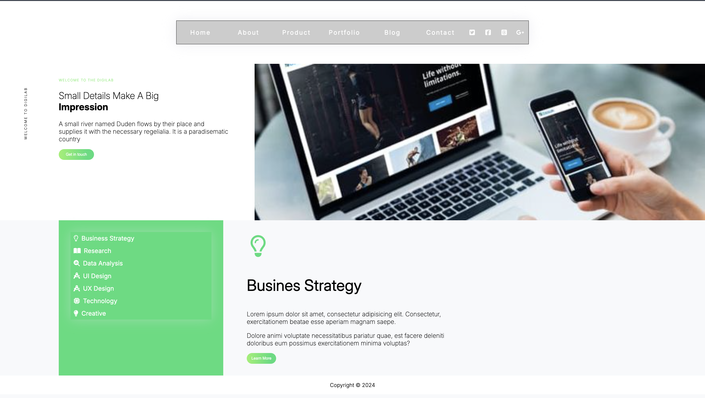

# 💡 Digilab Landing Page Clone

This project is a clone of a modern and minimalistic **landing page design**, recreated using **HTML** and **CSS** to demonstrate and improve my frontend development skills. The layout was inspired by a clean UI/UX example and enhanced with custom elements, including a navigation bar, responsive design, and sleek animations to give it a more professional and functional look.

## 📸 Preview



## 🚀 Features

- ✅ Responsive layout using **Flexbox**
- ✅ Custom **Navigation Bar**
- ✅ **Media Queries** for full mobile responsiveness
- ✅ Smooth **hover effects** and shadows
- ✅ Clean and modern **typography**
- ✅ Visual hierarchy using **icons** and color
- ✅ Structured layout with reusable **CSS classes**
- ✅ Extended customizations beyond original design

## 🧠 What I Learned

- Advanced use of **Flexbox** and layout techniques
- Writing **Media Queries** for multiple screen sizes
- Creating clean and responsive **UI components**
- Organizing a scalable project structure
- Enhancing UI/UX with animations and visual feedback
- Working with **custom icons** and images effectively

## 🌐 Technologies Used

- HTML5
- CSS3
- Google Fonts
- Font Awesome / Custom icons
- Media Queries
- Flexbox

## 📂 Project Structure

```bash
├── index.html          # Home — header/nav, hero, services sidebar, modal, footer
├── about.html / product.html / portfolio.html / blog.html / contact.html
├── styles.css
├── script.js           # nav-toggle, modal, form validation, services switcher
├── js/
│   ├── config.js       # DIGILAB.CONFIG — API_BASE, SEED_PATHS
│   ├── api.js          # DIGILAB.API.list(resource) — seed fetch now, API later
│   └── auth.js         # DIGILAB.Auth — localStorage prototype only
├── data/               # local seeds, all {"items":[...]}
│   ├── courses.json / services.json / testimonials.json
│   └── posts.json / events.json / ideas.json
├── docs/
│   ├── BRANCHING.md    # branch model + workflow
│   ├── CHANGELOG.md    # what changed on this branch
│   └── API_CONTRACT.md # seed shapes + API/auth usage
├── flex001.html
├── flex001.css
├── working.jpg
├── Result.png
```

## 🌿 Branching

Active: `feature/site-scaffold-and-seed-data` (see `docs/BRANCHING.md`).
`main` stays deployable — work in `feature/*`, PR to `main`.
Conventional commits: `feat|fix|docs|style(scope): summary`.

## ⚠️ Status (unwired)

`js/*` + `data/*` scaffolded but no HTML loads them yet. See `docs/API_CONTRACT.md` → Wiring status.
